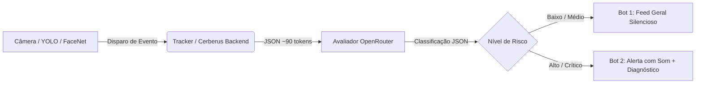

# 🤖 Arquitetura do Agente de IA para o Cerberus (Sentinela Vision)

Este documento estabelece o roadmap completo de capacidades inteligentes para o **Cerberus**, integrando um **Agente Autônomo de IA (via OpenRouter)** com a infraestrutura local acelerada por GPU (NVIDIA GTX 1660 + TensorRT).

> ### 🏛️ Princípios de Arquitetura:
> 1. **Visão Pesada 100% Local**: Detecção (YOLOv8 FP16), Reconhecimento Facial (FaceNet FP16) e Rastreamento (ByteTrack) rodam na GPU local a 30 FPS sem gastar 1 centavo nem enviar streams para fora.
> 2. **IA Contextual Sob Demanda (Event-Driven)**: O LLM/VLM só é acionado em momentos-chave, trabalhando em sua maioria com JSONs textuais ultracompactos (50 a 150 tokens).
> 3. **Arquitetura de Dois Bots no Telegram**:
>    - **Bot 1 (`@cerberus_karan_bot`)**: Feed Geral / Auditoria contínua (silencioso).
>    - **Bot 2 (`@cerberus_critico_bot`)**: Alertas Críticos prioritários com som e diagnóstico da IA quando o risco é **Alto**.
> 4. **Custo Quase Zero**: Modelos econômicos ou gratuitos (ex: `minimax/minimax-m3.1-flash:free`, `google/gemini-2.5-flash`, `deepseek/deepseek-chat`).

---

## 1. 🛡️ Avaliador de Suspeição e Risco Contextual `[IMPLEMENTADO ✅]`

### O que é:
Julgamento inteligente de ameaça cruzando horário, local da câmera, histórico de permanência e identificação biométrica.
- *Exemplo*: Um desconhecido ao meio-dia na calçada é classificado como `risco: baixo`. O mesmo desconhecido às 03:22 nos fundos por 38 segundos é classificado como `risco: alto`.

### Fluxo Operacional:

---

## 2. 💬 Chat / Assistente em Linguagem Natural pelo Telegram (`/pergunta` ou Mensagem Direta)

### O Problema:
Para auditar o que aconteceu no dia ou saber se alguém esteve em casa, o morador hoje precisa olhar logs manuais ou rolar dezenas de mensagens.

### Como o Agente Resolve:
O morador conversa diretamente com o bot no Telegram como se estivesse falando com um porteiro ou segurança particular:
- **Você pergunta no Telegram**:
  - *"O carteiro ou alguém de moto passou hoje de manhã?"*
  - *"A Ingrid já chegou em casa?"*
  - *"Alguém veio no portão enquanto eu estava no trabalho?"*
- **Fluxo do Agente**:
  1. O bot intercepta o texto e consulta o SQLite (`SELECT * FROM events WHERE timestamp >= 'hoje'`).
  2. Filtra os eventos relevantes e monta um prompt conciso com a lista estruturada (~150 tokens).
  3. O LLM formula uma resposta humana direta em 1 frase:
     > *"Sim, uma moto parou no portão às 10:42 da manhã por 2 minutos. A Ingrid chegou às 17:15 e seu carro já está na garagem."*

---

## 3. 📋 Briefing Executivo Diário / Resumo Noturno de Segurança

### O Problema:
Centenas de eventos ao longo do dia geram fadiga de alerta. O morador precisa ter certeza de que o perímetro está seguro antes de dormir.

### Como o Agente Resolve:
O Cerberus agenda um relatório automático em horários estratégicos (ex: às **22:00** para fechamento ou às **07:00** como despertar de segurança):
- **O Backend agrega**:
  - Total de movimentações do dia.
  - Horários de saída e chegada dos moradores conhecidos.
  - Quantidade de desconhecidos que passaram na calçada.
  - Tempo médio em que veículos ficaram estacionados na frente.
- **Mensagem formatada enviada ao Telegram**:
  > 📋 **Briefing de Segurança - 20/10/2026**
  > • **Status Geral**: Perímetro calmo e seguro.
  > • **Moradores**: Karan chegou às 18:15; Ingrid chegou às 17:10.
  > • **Carro**: Estacionado na Garagem desde as 18:20 (Placa `NEC4J83` conferida).
  > • **Visitantes**: 4 pedestres passaram pelo portão em horário comercial. Nenhuma permanência suspeita.
  > • **Madrugada**: Zero movimentações nas áreas restritas (Fundos e Garagem).

---

## 4. 🕵️‍♂️ VLM sob Demanda para Tirar-Dúvidas Visuais (*Vision Language Model*)

### O Problema:
Às vezes o detector local aponta uma silhueta suspeita, uma sombra ou alguém carregando um objeto estranho à noite, e o morador quer saber o que a pessoa está fazendo ou vestindo.

### Como o Agente Resolve:
Ao lado de cada alerta ou através de um comando no Telegram (ex: respondendo à foto com `/analisar`):
- O Cerberus envia a imagem do recorte (redimensionada para ~384px, ~20 KB) para um modelo multimodal econômico (`google/gemini-2.5-flash` ou `qwen/qwen-2.5-vl-7b-instruct`).
- **Prompt do Sistema**: *"Você é um perito em segurança. Descreva suscintamente o que o indivíduo está vestindo, segurando e sua postura corporal."*
- **Resposta do VLM**:
  > *"Indivíduo vestindo casaco preto com capuz, calça jeans e segurando uma sacola plástica na mão direita. Postura de caminhada normal, sem ferramentas aparentes."*

---

## 5. 🏷️ Categorização Semântica de Atividades e Rastreamento de Encomendas

### O Problema:
O detector YOLO clássico só rotula objetos isolados (`person`, `motorcycle`, `car`). Ele não entende o contexto da ação.

### Como o Agente Resolve:
O Cerberus analisa sequências temporais de eventos e solicita ao Agente uma etiqueta de intenção:
- `Moto` + `Pessoa com capacete/mochila` parando no portão ➔ Etiqueta: **"Entrega / Delivery / Motoboy"**
- `Carro estranho` parado com motor ligado em frente à garagem > 1 minuto ➔ Etiqueta: **"Veículo em Espera / Bloqueio de Guia"**
- `Pessoa desconhecida` tocando a grade do portão ➔ Etiqueta: **"Tentativa de Contato / Visita"**
- Essas tags ficam salvas no banco de dados e permitem buscas como: *"Mostre todas as entregas desta semana"*.

---

## 6. 🧠 Co-Piloto de Calibração Autônoma de Sensibilidade (*Self-Tuning AI*)

### O Problema:
Ajustar `confidence_threshold`, `iou_threshold` e `alert_cooldown_seconds` manualmente pode ser chato, resultando em falsos positivos (ex: vento balançando plantas ou reflexo de farol à noite).

### Como o Agente Resolve:
O agente monitora a taxa de eventos por hora de cada câmera:
- Se uma câmera na garagem disparou 15 alertas em 10 minutos sem nenhuma detecção facial confirmada e com baixa confiança:
  - O Agente diagnostica: *"A câmera da Garagem está sofrendo interferência de sombra/inseto."*
  - Recomenda ou ajusta automaticamente a sensibilidade daquela câmera até o amanhecer, evitando spam desnecessário.

---

## 7. 🚨 Protocolo de Resposta Ativa a Intrusão (*Defensive Actions*)

### O Problema:
Apenas avisar o morador pelo celular às 03:00 da manhã pode não ser suficiente caso ele esteja em sono profundo.

### Como o Agente Resolve:
Em caso de `risco: alto` confirmado pela IA na madrugada:
1. **Chamada de Alerta Telegram / Webhook**: Disparo de alerta contínuo que fura o modo "Não Perturbe" do smartphone.
2. **Integração com Casa Inteligente (Home Assistant / MQTT)**:
   - Acender instantaneamente os holofotes do quintal ou garagem para espantar o invasor.
   - Disparar um sinal sonoro ou sintetizar voz no alto-falante: *"Atenção: Área monitorada por câmeras."*

---

## 📊 Matriz de Priorização das Próximas Implementações

| Funcionalidade | Complexidade | Consumo de Tokens | Impacto no Dia a Dia |
| :--- | :---: | :---: | :--- |
| **1. Avaliador de Risco Contextual** | Baixa | ~100 tokens/alerta | **MÁXIMO** `[CONCLUÍDO ✅]` |
| **2. Chat pelo Telegram (`/pergunta`)** | Média | ~180 tokens/pergunta | **ALTO** (Saber o histórico em segundos) |
| **3. Resumo Diário / Noturno Automático** | Baixa | ~200 tokens/dia | **ALTO** (Paz de espírito antes de dormir) |
| **4. VLM sob demanda (`/analisar`)** | Baixa | ~250 tokens/imagem | **MÉDIO** (Tirar dúvidas sobre pessoas suspeitas) |
| **5. Categorização de Entregas / Delivery** | Média | ~80 tokens/evento | **MÉDIO** (Organização do histórico residencial) |

---

## 💰 Estimativa de Custos Mensais na OpenRouter

Com o modelo atual (`minimax/minimax-m3.1-flash:free`), o custo é **R$ 0,00**.
Caso opte por modelos comerciais de altíssima velocidade como `google/gemini-2.5-flash` ou `deepseek/deepseek-chat`:
- ~10 avaliações de risco por dia: **30.000 tokens/mês**
- Resumo diário (1x ao dia): **6.000 tokens/mês**
- Dúvidas e consultas esporádicas: **15.000 tokens/mês**
- **Custo total estimado**: **Menos de R$ 0,50 por mês**.
