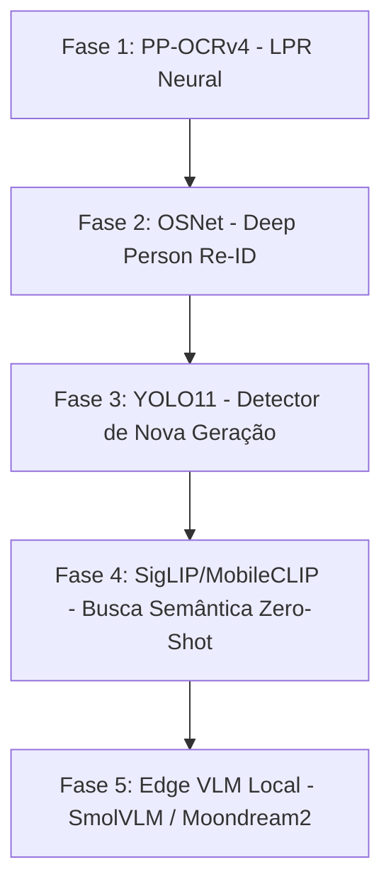

# 🚀 Plano Estratégico de Implantação: Modelos Neurais SOTA no Cerberus

Este documento estabelece o roteiro de evolução arquitetural dos modelos de Inteligência Artificial do **Cerberus**, substituindo modelos legados ou limitados por arquiteturas **State-of-the-Art (SOTA)** em visão computacional, deep metric learning e modelos multimodais de borda (*Edge AI*).

Cada fase é independente, modular e será implementada, testada e validada **uma de cada vez**, respeitando os limites de hardware da **NVIDIA GeForce GTX 1660 (6 GB VRAM)** no servidor **Nobara Linux 44**.

---

## 📊 Visão Geral das Fases

---

## 📌 Fase 1: Modernização do OCR de Placas (PP-OCRv4 / SVTR)
> **Prioridade**: Alta  
> **Componente Alvo**: `app/detector/recognizer.py` & `scripts/diagnose_plate.py`  
> **Objetivo**: Substituir o motor legado Tesseract 5.5 por uma rede neural profunda de detecção e reconhecimento de texto em tempo real.

### 1.1 Justificativa Técnica
- O Tesseract atual foi concebido para digitalização de documentos e falha severamente em placas automotivas reais devido a:
  - Ângulos de visão oblíquos (câmera alta no portão/garagem);
  - Reflexos de iluminação, faróis e chuvas;
  - Latência elevada (~200 a 400 ms por recorte de placa).
- O **PP-OCRv4** combina:
  1. **DBNet**: Rede neural convolucional leve para detecção de polígonos de texto deformados.
  2. **SVTR (Single Visual Model for Text Recognition)**: Baseado em Transformers leves, lê caracteres mesmo inclinados em ~8 a 15 ms via ONNX Runtime / TensorRT.

### 1.2 Entregáveis da Fase
1. Instalação e empacotamento do modelo PP-OCRv4 leve em formato ONNX (com execução via `CUDAExecutionProvider`).
2. Atualização da rotina `extract_plate_text()` em `app/detector/recognizer.py` para usar o pipeline neural antes do fallback.
3. Criação de script de validação de latência e acurácia (`scripts/benchmark_ppocr.py`).

---

## 📌 Fase 2: Biometria Corporal Contínua (OSNet - Person Re-ID)
> **Prioridade**: Alta  
> **Componente Alvo**: `app/detector/recognizer.py` & `app/detector/tracker.py`  
> **Objetivo**: Rastrear e reconhecer pessoas conhecidas mesmo quando estiverem de costas, com capuz, boné ou distantes da câmera.

### 2.1 Justificativa Técnica
- Atualmente, o Cerberus conta com **InsightFace (ArcFace)** para reconhecimento facial. Se a pessoa virar o rosto ou estiver de costas, o sistema perde o reconhecimento e a classifica como pedestre genérico.
- O **OSNet (Omni-Scale Network)** extrai um vetor métrico (*embedding* de 512 dimensões) do **corpo inteiro** da pessoa, considerando:
  - Cores e padrões de vestimenta;
  - Proporções antropométricas e silhueta corporal;
  - Aspectos posturais.
- **Fusão Biométrica**: Quando o rosto for visível, o ArcFace atualiza o perfil e associa o corpo ao mesmo morador. Quando o rosto não estiver visível, o OSNet mantém o vínculo de identidade da pessoa durante toda a sua permanência na propriedade.

### 2.2 Entregáveis da Fase
1. Conversão e carregamento do modelo OSNet x0.25 / x0.5 em ONNX/PyTorch CUDA.
2. Extração de vetor de Re-ID para cada `track_id` no ciclo de vida do rastreador.
3. Banco de perfis corporais associados aos moradores cadastrados.
4. Script de teste de verificação cruzada frente/costas (`scripts/test_reid.py`).

---

## 📌 Fase 3: Upgrade do Detector Principal (YOLO11 em TensorRT FP16)
> **Prioridade**: Média-Alta  
> **Componente Alvo**: `models/` & `app/detector/engine.py`  
> **Objetivo**: Elevar a precisão de detecção e reduzir falsos positivos em oclusões parciais.

### 3.1 Justificativa Técnica
- O Cerberus usa o `yolov8n.engine` gerado em FP16.
- O **YOLO11** (lançado pela Ultralytics no fim de 2024) introduziu blocos `C3k2` e atenção espacial `C2PSA` (*Cross-Stage Partial with Spatial Attention*).
- Entrega ganho de +1.5 a +2.0 mAP com contagem de parâmetros similar ou inferior ao YOLOv8, com tempo de inferência equivalente (~6 a 8 ms na GTX 1660 via TensorRT).

### 3.2 Entregáveis da Fase
1. Exportação do `yolo11n.pt` para ONNX e compilação do engine `yolo11n.engine` via `trtexec` com FP16.
2. Verificação de compatibilidade dos tensores de saída no `app/detector/engine.py`.
3. Script de benchmark de FPS e consumo de VRAM (`scripts/test_yolo11_perf.py`).

---

## 📌 Fase 4: Busca Semântica por Linguagem Natural (SigLIP / MobileCLIP)
> **Prioridade**: Média  
> **Componente Alvo**: `app/storage/database.py` & Telegram Bot  
> **Objetivo**: Permitir buscar qualquer momento ou objeto no histórico de gravações usando descrições em texto livre.

### 4.1 Justificativa Técnica
- Modelos CLIP/SigLIP projetam imagem e texto no mesmo espaço vetorial multidimensional.
- Ao salvar um evento com foto, geramos e armazenamos o embedding visual (ex: 512 floats no SQLite).
- No Telegram, o usuário pode enviar:
  - `/buscar carro prata com escada`
  - `/buscar homem de casaco vermelho`
  - `/buscar cachorro correndo perto do portão`
- O Cerberus calcula a similaridade de cosseno em memória em < 5 ms e retorna as fotos mais prováveis instantaneamente, sem precisar de modelo treinado para cada objeto específico.

### 4.2 Entregáveis da Fase
1. Integração do SigLIP-Nano ou MobileCLIP via ONNX Runtime CUDA.
2. Adição de coluna de embedding semântico na tabela `events` do SQLite.
3. Comando `/buscar <texto>` nos bots do Telegram.

---

## 📌 Fase 5: IA Multimodal Local de Borda (Edge VLM: SmolVLM / Moondream2)
> **Prioridade**: Média-Avançada  
> **Componente Alvo**: `app/agent/` & `app/main.py`  
> **Objetivo**: Análise visual profunda e auditoria de segurança 100% offline e privada, direto na GPU local.

### 5.1 Justificativa Técnica
- Atualmente, a inteligência contextual depende de APIs de nuvem (OpenRouter / Minimax / Gemini).
- Modelos como **Moondream2** (1.8B) ou **SmolVLM** (2B) podem rodar localmente quantizados em INT4 / FP16 ocupando apenas ~1.5 GB a 2.0 GB de VRAM.
- Como a GTX 1660 tem 6 GB e os modelos atuais (YOLO + InsightFace) consomem apenas ~1.2 GB, sobra espaço confortável para manter o VLM carregado em memória.
- Permite analisar frames em tempo real: *"A pessoa que tocou a campainha está uniformizada?"*, *"O portão ficou escancarado?"*, tudo sem conexão com a internet.

### 5.2 Entregáveis da Fase
1. Carregamento do Moondream2 / SmolVLM quantizado via ONNX Runtime ou llama.cpp/vLLM local.
2. Endpoint `/api/v1/vlm/ask` e integração no fluxo de avaliação de risco do Cerberus.
3. Teste de consumo de VRAM e tempo de geração de resposta local.

---

## 🚦 Roteiro de Execução Passo a Passo

| Passo | Modelo / Tecnologia | Status | Impacto Imediato |
| :---: | :--- | :---: | :--- |
| **Passo 1** | **PP-OCRv4 (LPR Neural)** | ✅ **Concluído & Validado** | Leitura rápida e confiável de placas no portão e garagem |
| **Passo 2** | **OSNet (Deep Re-ID)** | ⏳ **Próximo** | Rastreamento de moradores mesmo de costas/capuz |
| **Passo 3** | **YOLO11 (TensorRT FP16)** | 📋 Planejado | Menos falsos positivos e maior acurácia em oclusões |
| **Passo 4** | **MobileCLIP / SigLIP** | 📋 Planejado | Busca no histórico por texto livre no Telegram |
| **Passo 5** | **Edge VLM (Moondream2)** | 📋 Planejado | Análise visual avançada 100% offline na GPU |

---
*Documento versionado no repositório Cerberus. Cada etapa só será dada como concluída após teste prático com métricas de tempo e assertividade no servidor real.*
