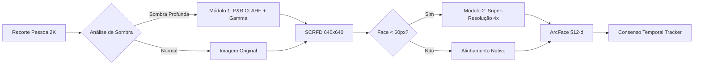

# 📋 Plano de Acompanhamento: Restauração e Super-Resolução Facial SOTA

> **Objetivo**: Superar limitações ópticas de câmeras 2K com grande-angular (rostos distantes de 30-40px em sombras profundas sob marquises) através de pipeline 100% via software, sem alterações nas configurações físicas das câmeras.

---

## 🏗️ Status Geral das Etapas

- [x] **Módulo 1: Realce Fotométrico Adaptativo (P&B + CLAHE & Shadow Lifting)** ✅ *Concluído & Validado*
  - [x] Especificação e desenho técnico do realce fotométrico.
  - [x] Adicionar parâmetros de shadow lifting em `app/core/config.py`.
  - [x] Implementar `enhance_shadow_face` e detecção *Dual-Pass* em `app/detector/recognizer.py`.
  - [x] Criar ferramenta de teste e comparação visual: `scripts/test_shadow_lifting.py`.
  - [x] Validar ganho de detecção em recortes escuros no Nobara Linux (2 rostos resgatados de sombras profundas a 3ms!).

- [x] **Módulo 2: Super-Resolução Facial Neural (AI Face Restoration ONNX FP16)** 🚀 *Concluído - Pronto para Validação*
  - [x] Implementar motor de Super-Resolução Facial ONNX em `app/ai/face_super_res.py`.
  - [x] Adicionar suporte a download automático do modelo ultraleve em `models/`.
  - [x] Integrar ampliação 4x condicional para faces com tamanho < 60px no pipeline ArcFace.
  - [x] Criar ferramenta de teste e benchmark: `scripts/test_face_super_res.py`.
  - [ ] Validar no Nobara Linux e inspecionar mosaico gerado `data/super_res_demo.jpg`.

- [ ] **Módulo 3: Integração Completa, Validação & Consenso Temporal** ⏳ *Pendente*
  - [ ] Conectar o pipeline completo (P&B CLAHE -> SCRFD 640 -> Super-Resolução -> ArcFace 512-d).
  - [ ] Ajustar o `TrackerManager` para manter o histórico de assinaturas faciais restauradas.
  - [ ] Executar auditoria biométrica completa com o script `diagnose_face_biometrics.py`.
  - [ ] Homologação em produção no servidor Nobara Linux 44.

---

## 📊 Arquitetura do Fluxo de Dados

---

## 📝 Registro de Atualizações
- **2026-10-21**: Criação do plano e inicialização do Módulo 1 (Realce Fotométrico e P&B CLAHE).
