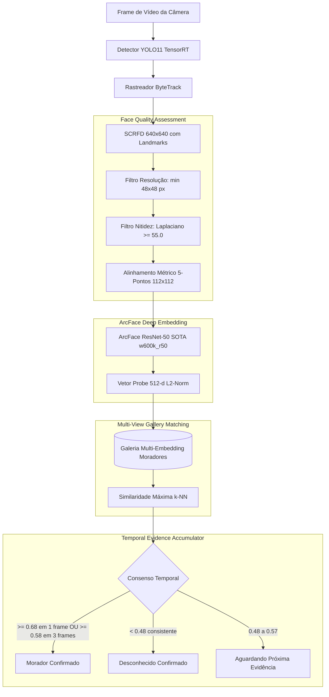

# Especificação de Design: Reconhecimento Facial SOTA de Alta Precisão (Cerberus)

- **Data**: 21/10/2026
- **Autor**: Antigravity & Karan
- **Componente**: `app/detector/recognizer.py`, `app/detector/tracker.py`, `app/core/config.py`
- **Status**: Proposta em Revisão

---

## 1. Diagnóstico do Problema Atual

O sistema atual apresenta dois problemas complementares:
1. **Falsos Positivos**: Pessoas desconhecidas sendo reconhecidas como moradores.
2. **Falsos Negativos**: Moradores reais cadastrados em `data/known_faces/` não sendo identificados.

### Causas Raízes Identificadas:
1. **Centróide Médio Diluído**: A função `load_known_faces()` calcula a média aritmética simples (`np.mean`) de todas as fotos de uma pessoa. Variações de ângulo, corte ou iluminação distorcem o vetor médio e reduzem drasticamente a similaridade com o rosto real da câmera.
2. **Detecção de Faces Minúsculas (Alucinação)**: O limiar de 18x18 pixels (`fw >= 18 and fh >= 18`) aceita borrões sem estrutura biométrica. No ArcFace (512 dimensões), dados ruidosos caem em regiões aleatórias do hiperespaço esférico, colidindo com cadastros existentes.
3. **Resolução de Detecção Baixa**: O SCRFD estava configurado em `det_size=(320, 320)`, perdendo detalhes finos de rostos a mais de 3 metros da câmera.
4. **Decisão por Frame Único sem Consenso**: Um único frame com ruído óptico que pontue $\ge 0.52$ crava a identidade do rastro para sempre. Da mesma forma, se o primeiro frame registrar 0.49 enquanto o morador ainda está distante, ele é alertado prematuramente como desconhecido.

---

## 2. Arquitetura SOTA Proposta

---

## 3. Detalhamento dos Componentes

### 3.1 Upgrade do Modelo: Buffalo_l (ArcFace ResNet-50)
- **Detector**: SCRFD-10G (alta precisão em ângulos de até 60 graus de yaw e inclinações de pitch).
- **Resolução de Detecção**: `det_size=(640, 640)` para preservar detalhes em câmeras Full HD/2K.
- **Extrator**: ArcFace ResNet-50 (`w600k_r50`), treinado em 600 mil identidades. Latência na GTX 1660: ~3.5 ms.
- **Fallback Automático**: Se o modelo grande não estiver disponível, faz fallback automático e transparente para `buffalo_s`.

### 3.2 Galeria Multi-Embedding por Morador
- Cada foto válida na pasta do morador (`data/known_faces/<Nome>/`) gera seu próprio vetor normalizado de 512 dimensões.
- **Matching**: Para uma face detectada $p$, a similaridade com um morador é a pontuação da melhor foto compatível:
  $$S(p, \text{morador}) = \max_{e \in \text{Fotos}} (p \cdot e)$$
- Permite cadastrar fotos em diferentes poses (frente, 3/4, com óculos, boné, iluminação diurna e noturna) sem que uma foto degrade a outra.

### 3.3 Filtro de Qualidade de Imagem (Face Quality Assessment - FQA)
- **Tamanho Mínimo**: $\ge 48 \times 48$ pixels na imagem original.
- **Proporção Anatômica**: Aspect ratio entre 0.65 e 1.40.
- **Detector de Movimento Borrado (Blur Gate)**:
  - Calcula a variância do Laplaciano da face: $\text{Var}(\nabla^2 I) \ge 55.0$.
  - Descarta rostos borrados antes de consultar a biometria, eliminando a principal fonte de falsos positivos.

### 3.4 Acumulador de Evidências Temporais no Rastreador (`tracker.py`)
- Cada rastro de pessoa (`TrackedEntity`) mantém um histórico recente de até 10 pontuações biométricas:
  - **Identificação Instantânea**: Se atingir similaridade $\ge 0.68$, confirma imediatamente o morador.
  - **Identificação por Consenso**: Se atingir pelo menos 3 frames com similaridade $\ge 0.58$, confirma o morador.
  - **Desconhecido Seguro**: Se tiver ao menos 3 detecções com qualidade aprovada e similaridades consistentemente $< 0.50$, dispara o alerta de desconhecido com total certeza.
  - **Incerteza Protegida**: Se a similaridade ficar na faixa ambígua (0.50 a 0.57), não dispara falso alarme; aguarda a pessoa dar mais 2 ou 3 passos na direção da câmera.

---

## 4. Ferramentas de Suporte e Calibração

1. **Script de Auditoria de Fotos (`scripts/diagnose_face_biometrics.py`)**:
   - Analisa cada imagem da pasta `data/known_faces/`.
   - Informa se o rosto foi detectado com sucesso, a resolução do recorte e o nível de nitidez (Laplaciano).
   - Gera matriz de similaridade cruzada (garante que Karan não pontua alto contra Ingrid ou vice-versa).
2. **Atualização da Configuração em `app/core/config.py`**:
   - `face_confidence_threshold: float = 0.58`
   - `face_instant_threshold: float = 0.68`
   - `face_min_size: int = 48`
   - `face_quality_min_blur: float = 55.0`
   - `face_temporal_votes: int = 3`

---

## 5. Plano de Validação e Testes
1. Rodar `diagnose_face_biometrics.py` nas fotos atuais de `data/known_faces/` para auditar a base cadastrada.
2. Testar contra os 184 recortes reais salvos em `data/events/`.
3. Validar ausência de falsos positivos com desconhecidos reais gravados pela câmera da rua.
4. Validar reconhecimento preciso dos moradores cadastrados.
